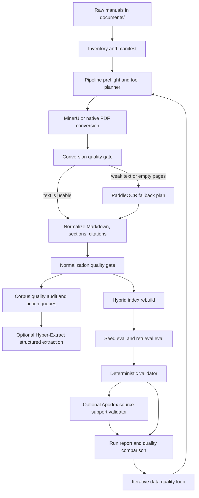
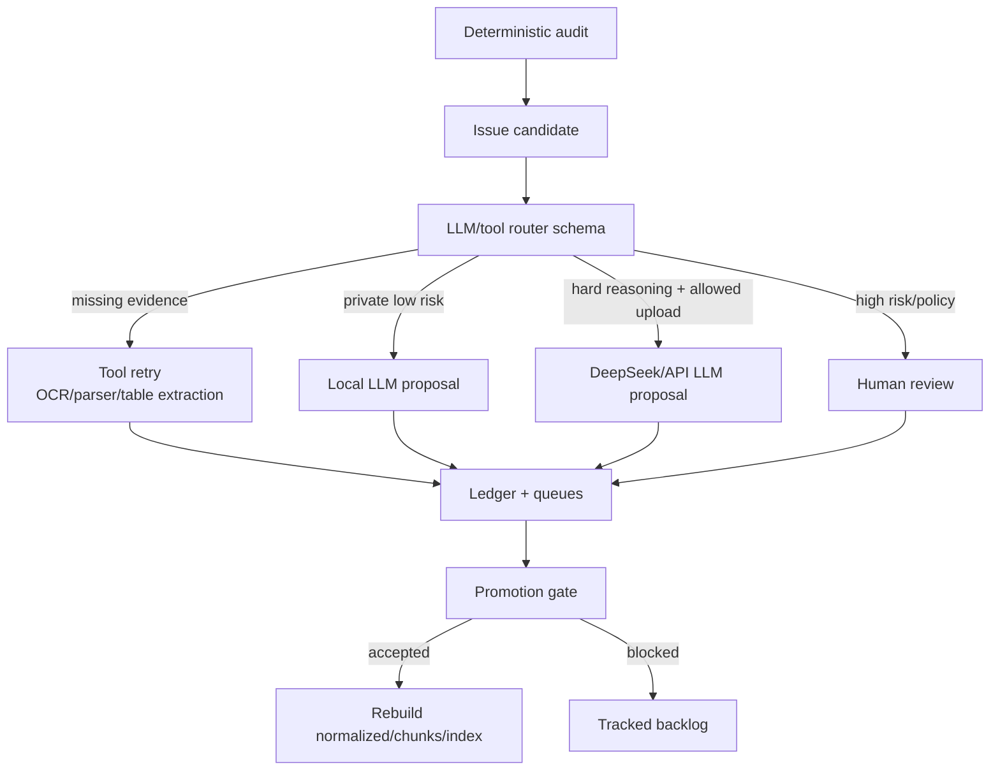

# Agentic Data Processing Architecture

This architecture makes the data pipeline automatic without letting an LLM agent
freely mutate source data or upload full manuals.



## Tool Roles

| Tool | Default role | When to run | Why not always run |
|---|---|---|---|
| MinerU | Primary converter | PDFs/Office docs when enabled and stable | Heavy runtime; native fallback is enough for text-rich files |
| PaddleOCR | Page-level OCR fallback | Pages with weak embedded text or empty conversion output | Slow; requires page rendering; can damage good embedded text if overused |
| Local LLM | Private structured reviewer | Low-risk cleanup, keyword enrichment, short validator checks | Weaker reasoning than large API models; still needs schema and logs |
| DeepSeek/API LLM | High-reasoning structured reviewer | Table/procedure/flow proposals, answer grounding, root-cause classification | Requires explicit external upload gate and minimized snippets |
| AI Agent CLI such as Codex | Investigator and repair worker | Failed evals, root-cause QA, code/schema/doc fixes, proposal integration | Too heavy for routine hot-path checks; must have bounded scope |
| Hyper-Extract | Structured knowledge extraction | Selected normalized chunks: alarms, failures, service flow, safety, parts | Needs LLM/API; not a PDF converter; may add noisy graph facts |
| Apodex | Optional answer/citation validator | Eval samples or high-risk answers | Requires a local/OpenAI-compatible serving endpoint; adds latency |
| Apodex semantic review | Patch proposal generator | Noisy/high-risk Markdown chunks after conversion | Must stay non-destructive; cannot invent missing OCR/table/image content |
| Corpus quality audit | Deterministic loop-check | Every build and every quality loop iteration | It creates queues; it does not repair data by itself |

## Guardrails

- `documents/` remains raw immutable source.
- Optional AI tools are disabled by default.
- External upload is blocked unless `HYPER_EXTRACT_ALLOW_EXTERNAL=true` or
  `LLM_EXTERNAL_UPLOAD_ALLOWED=true` or `APODEX_ALLOW_EXTERNAL=true`.
- Pipeline state and reports are written under `artifacts/pipeline/`.
- Each run compares baseline vs final quality metrics.
- LLM-assisted decisions follow `docs/llm-assisted-data-and-audit-blueprint.md`.
- No LLM output may become canonical data without a proposal ledger, risk label,
  promotion gate, and rollback path.
- AI Agent CLI outputs follow the same rule: agents may inspect, patch, and
  propose, but source-backed evidence and promotion gates still decide.

## LLM-Assisted Loop-Check

The pipeline should use LLMs where the work is semantically hard, not where a
deterministic tool is more trustworthy.

| Stage | LLM Role | Required Artifact |
|---|---|---|
| Conversion QA | Judge whether weak text/table/figure regions need OCR, parser retry, or human review. | `artifacts/pipeline/` issue report with source ids. |
| Normalization QA | Propose RAG-friendly structure for tables, warnings, procedures, and diagrams. | Proposal JSON/Markdown under `artifacts/reviews/`. |
| Chunk QA | Detect overlong, noisy, duplicated, or broken chunks. | Quality-loop queue item and ledger row. |
| Technical enrichment | Propose alarms, parts, software versions, service steps, and relationships. | Non-canonical metadata proposal with citations. |
| Answer QA | Check claim grounding, citation alignment, and missing context. | Eval/log record with root-cause class. |

Routing order:

```text
deterministic check
-> tool retry when evidence is missing or layout-bound
-> local LLM when private/low-risk review is enough
-> API LLM when reasoning quality matters and upload is allowed
-> human review for legal, safety, service, or policy-sensitive changes
```

The loop-check router should write an explicit row for every route decision.
The row must include `issue_id`, `source_ids`, `actor_type`, `actor_name`,
`decision`, `risk_level`, `blocked_reason`, `proposal_path`, and
`requires_human_review`.

## AI Agent CLI Use In The Pipeline

Use Codex or another AI Agent CLI when the task requires tool use plus reasoning,
not just a single model judgment.

Good agent tasks:

- investigate a failed eval by reading the eval case, chat log, retrieval hits,
  chunk plan, citation map, and source preview;
- review a quality-loop queue and turn repeated failures into a concrete patch
  plan or eval expansion;
- patch repository code or docs when the failure is in pipeline behavior,
  schemas, logs, or tests;
- compare artifacts before and after OCR/normalization/chunking changes;
- produce a root-cause report that tells whether the fix belongs in data,
  retrieval, citation, LLM prompt/schema, policy, or eval coverage.

Poor agent tasks:

- validating JSON, counting chunks, checking file existence, hashing files;
- composing every user answer in the runtime chat path;
- rewriting normalized manuals without proposal ledger and promotion gate;
- running broad cleanup without a measured failure group.

Agent task outputs should be concrete and reviewable:

- `artifacts/reviews/agent_tasks/<task_id>/report.json`
- `artifacts/reviews/agent_tasks/<task_id>/report.md`
- patches to repo code/docs/eval when the task explicitly allows edits;
- verification command results.

## Agent-Friendly CLI Requirements

The project CLI should remain comfortable for AI agents to call:

- JSON to stdout by default; human-readable formatting should be opt-in.
- Structured error objects with stable `code`, `message`, and `suggestion`.
- Non-zero exit code on failure; parameter errors should fail fast.
- Logs, progress, and warnings should go to stderr, not stdout.
- No interactive prompt for missing data in pipeline/eval commands.
- Destructive or mutating commands should support dry-run or explicit approval
  when they are added.
- Command outputs should include paths to generated artifacts so agents can
  inspect the next relevant file instead of guessing.

## Target Data Review Workflow



Expected proposal outputs:

- Markdown tables for noisy table spans.
- Mermaid graphs for troubleshooting relationships.
- Procedure chunk plans that preserve step order.
- Warning/caution block repair plans.
- Low-value exclusion proposals for exact boilerplate/noise.
- Metadata enrichment proposals with citations.

All of these remain derived proposals until the promotion gate accepts them.

## Public Interfaces

- CLI: `python -m baxter_rag.cli --root . pipeline-run`
- CLI latest report: `python -m baxter_rag.cli --root . pipeline-report`
- API: `POST /api/pipeline/run`
- API: `GET /api/pipeline/report/latest`
- API: `GET /api/pipeline/state/latest`
- CLI: `python -m baxter_rag.cli --root . quality-audit`
- API: `POST /api/quality-audit/run`
- CLI: `python -m baxter_rag.cli --root . semantic-review --limit 12`
- CLI: `python -m baxter_rag.cli --root . semantic-review --limit 12 --enable-llm-review --allow-external`
- CLI: `python -m baxter_rag.cli --root . quality-loop --max-iterations 3 --review-limit 12`
- API: `POST /api/reviews/apodex-semantic`
- API: `POST /api/reviews/llm-semantic`
- API: `POST /api/quality-loop/run`

## Semantic Review Rules

DeepSeek/API LLMs, local LLMs, and Apodex may suggest Markdown repairs only as
proposals. They must not directly change `normalized.md`.

Local Apodex setup:

```powershell
.\scripts\start-apodex.ps1
.\scripts\run-apodex-semantic-review.ps1 -DocId prismax_service_manual_aw8047 -Limit 2
```

The default local endpoint is `http://127.0.0.1:8000/v1`. The current CPU
profile uses a GGUF Q4_K_M model and `ctx-size=4096`, which is good enough for
short validator proposals but not ideal for high-throughput chat.

DeepSeek/API review setup:

```powershell
$env:LLM_BASE_URL="https://api.deepseek.com"
$env:LLM_API_KEY="..."
$env:LLM_MODEL="deepseek-v4-flash"
$env:LLM_EXTERNAL_UPLOAD_ALLOWED="true"
$env:LLM_SEMANTIC_REVIEW_ENABLED="true"
python -m baxter_rag.cli --root . semantic-review --limit 12 --enable-llm-review --allow-external
```

Only minimized snippets, chunk ids, citation ids, and surrounding context should
be sent. Full manuals must not be uploaded.

## Iterative Quality Loop

The quality loop is the long-running cleanup workflow. It may run for hours and
is designed to make the dataset cleaner over repeated passes. Each iteration
starts with a full corpus audit before optional semantic review.

```powershell
.\scripts\run-quality-loop.ps1 -MaxIterations 5 -ReviewLimit 20 -UseApodex
```

Principles:

- Audit rules cover add/remove/repair/reorder classes: metadata enrichment, OCR
  retry, duplicate exclusion review, encoding repair, chunk repair, citation
  repair, table/figure extraction, and index rebuild.
- The loop is deterministic in routing: every candidate becomes a ledger row and
  queue item.
- LLM/model outputs are proposals, not canonical changes.
- OCR gaps go to `ocr_retry`.
- Alarm, service, safety, maintenance, and calibration patches go to
  `human_review_patch` even when the model is confident.
- `safe_auto_patch` mode exists only for low-risk, evidence-exact cleanup after
  guardrails pass. The default is `proposal_only`.
- Each run writes `artifacts/quality_loop/runs/<loop_id>/ledger.jsonl` and
  `queues.json`, so later OCR/VLM/DeepSeek/local-model stages can process the
  right queue without random behavior.

Allowed proposal types:

- remove duplicate headers, footers, dot-leader table-of-contents noise;
- repair obvious word spacing artifacts when evidence is local and exact;
- split overlong high-value chunks while preserving step order;
- mark missing pages as `needs_ocr`.

Forbidden proposal types:

- add facts, warnings, alarm actions, numbers, units, part numbers, software
  versions, or clinical/service instructions not present in evidence;
- summarize away safety warnings;
- repair empty pages from language-model guessing.

## Expected Quality Impact

The pipeline improves operational quality immediately: repeatable runs, quality
gates, saved reports, OCR candidate detection, and safer optional-tool routing.

Answer quality improves only when a real bottleneck is present and the matching
tool is active:

- If conversion loses text, PaddleOCR/MinerU OCR can improve recall.
- If questions need structured failure relationships, Hyper-Extract can improve
  lookup and multi-hop retrieval after review.
- If LLM answers drift beyond sources, Apodex-style validation can reduce bad
  answers but costs extra latency.

For the current Baxter corpus, most PDFs already have embedded text. Therefore
the first measurable gain is likely auditability and reliability, not a large
retrieval-score jump.
