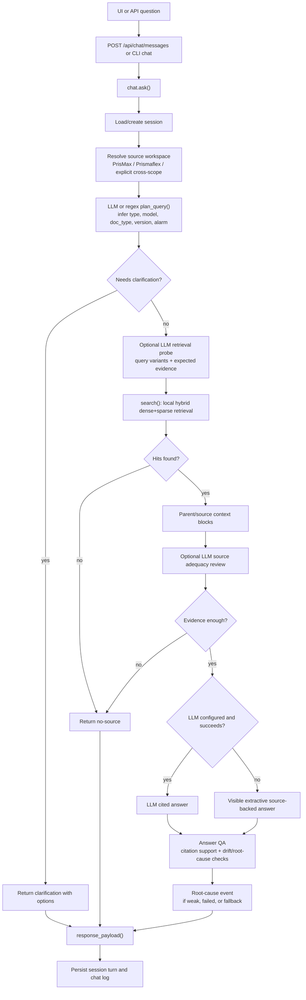

# AI Answer Workflow

Generated: 2026-06-21

This is the user-chat answer workflow after documents have been inventoried, converted, normalized, cited, chunked, and indexed.

## Runtime Contract

- Chat must answer only from retrieved Baxter source evidence.
- Chat should use the selected source workspace as a hard retrieval scope when one is set. Initial primary workspaces are PrisMax and Prismaflex.
- The MVP workspace model is intentionally minimal: workspace selection, thread history, retrieval scope, citations, and logs. Do not add unrelated workspace settings until they change answer behavior.
- Vietnamese output is preferred for users.
- `answer_source` must reveal whether the answer came from LLM, extractive no-LLM mode, extractive LLM-error fallback, clarification, or no-source.
- Extractive fallback is allowed only when it is visible and source-backed.
- No retrieval hits must produce no-source or clarification, not invented technical guidance.
- Service, alarm, safety, calibration, and maintenance answers must be conservative and cited.
- LLM calls that influence planning, answering, or QA should be schema-bound and logged when practical.
- Answer failures should be classified by root cause so fixes target data, retrieval, citation, or model behavior.

## Single Flow



## Retrieval Contract

- `rebuild_index()` builds `artifacts/index/chunks.jsonl` from normalized metadata, citation maps, and chunk plans.
- `search()` filters candidates by source-backed metadata and fuses dense hash vectors with BM25 using RRF.
- Source workspace filters are applied before retrieval. If a workspace is selected, missing evidence returns no-source-in-scope or clarification instead of silently widening to the whole corpus.
- Parent context expansion is allowed to give surrounding section evidence.
- Metadata boosts may improve ranking but must not replace evidence.

## LLM Assistance Contract

Allowed LLM roles:

- structured query planning and scope inference;
- retrieval probe or expansion proposal;
- source adequacy review before answer composition;
- cited Vietnamese answer composition from retrieved context;
- citation-support and answer-drift checking;
- eval judging and root-cause classification.

Required boundaries:

- do not answer from model memory;
- do not hide provider failure;
- do not override no-source or clarification when evidence is weak;
- do not accept unsupported claims even if the answer sounds fluent;
- log whether failures appear caused by `source_missing`, `conversion_loss`,
  `normalization_noise`, `metadata_gap`, `retrieval_miss`,
  `context_insufficient`, `llm_drift`, `citation_error`, `policy_block`, or
  `eval_gap`.

## Target LLM Answer Stages

| Stage | LLM Role | Schema Output | Fallback If Missing Or Fails |
| --- | --- | --- | --- |
| Query planning | Infer scope, model, doc type, version, risk, and retrieval query. | `QueryPlan` | Regex planner with `plan_source=regex_*`. |
| Retrieval probe | Suggest query variants, required entities, preferred doc types, and stop conditions. | `RetrievalProbe` | Use original query and repository filters. |
| Source adequacy | Decide whether retrieved evidence is enough, contradictory, or missing context. | `SourceAdequacyReview` | Continue only when deterministic hits exist; otherwise no-source or clarification. |
| Answer composition | Write Vietnamese answer from context only, with chunk-backed citations. | `CitedAnswer` | Visible extractive fallback. |
| Grounding QA | Validate claims, citations, unsupported content, and safe response action. | `AnswerGroundingReview` | Keep answer only if validator passes or is unavailable by policy; log the gap. |
| Root-cause classification | Explain why an answer failed or fell back. | `AnswerFailureRootCause` | Default to explicit `unknown` plus raw error. |

LLMs may replace brittle hand-written reasoning at these stages, but they must
not replace retrieval ownership, citation maps, source preview, or visible
fallback labels.

## Answer Audit Events

Every chat turn should be able to produce an audit trace:

```text
question
-> query_plan
-> retrieval_probe
-> search_hits
-> source_adequacy_review
-> answer_composition
-> grounding_review
-> final_payload
-> feedback/eval_case/root_cause
```

Minimum logged fields:

- `trace_id`, `session_id`, `turn_id`, `created_at`
- `plan_source`, `answer_source`, `no_answer_reason`, `llm_error`
- `source_workspace_id`, `cross_scope_mode`, `retrieval_query`, `filters`, `hit_count`, `citation_count`
- `llm_provider`, `llm_model`, `llm_usage`
- `grounding_decision`, `unsupported_claims`, `citation_errors`
- `safe_response_action`, `root_cause`, `requires_human_review`

## Fallback Contract

Allowed:

- `extractive_no_llm`: LLM is not configured; answer is source excerpts with citations.
- `extractive_fallback`: LLM call failed; response includes `llm_error` and remains source-backed.
- `clarification`: model/manual scope is missing and multiple indexed models are plausible.
- `no_source`: retrieval found no suitable source.
- `no_source_in_scope`: retrieval found no suitable source inside the selected workspace; the user may change workspace or ask for explicit cross-scope search.

Not allowed:

- Hiding LLM/provider failure.
- Answering from model knowledge without retrieved source evidence.
- Adding facts not present in retrieved or cited source text.
- Using optional tools as an answer source without the same citation contract.
- Letting a schema-free LLM judgment silently change answer policy, fallback, or citations.

## Key Files

- `baxter_rag/chat.py`: session state, query planning, answer contract, fallback labels, chat logs.
- `baxter_rag/retrieval.py`: local hybrid index, filters, RRF, metadata boosts, parent context.
- `baxter_rag/evaluation.py`: seed cases and source-backed eval runs.
- `baxter_rag/api.py`: API endpoints for chat, source preview, pipeline, eval, and feedback.
- `baxter_rag/pipeline.py`: guarded end-to-end data automation.
- `baxter_rag/quality_loop.py`: long-running data cleanup workflow.
- `baxter_rag/semantic_review.py`: Apodex proposal generation.
