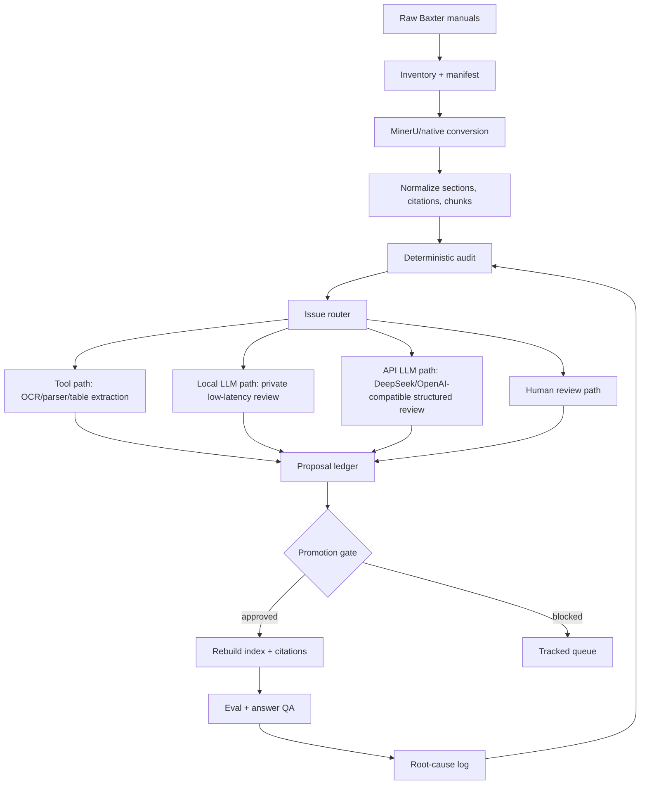
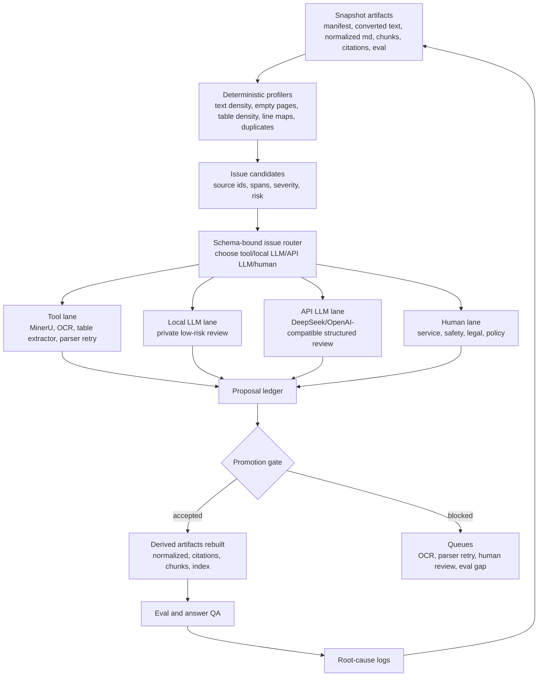
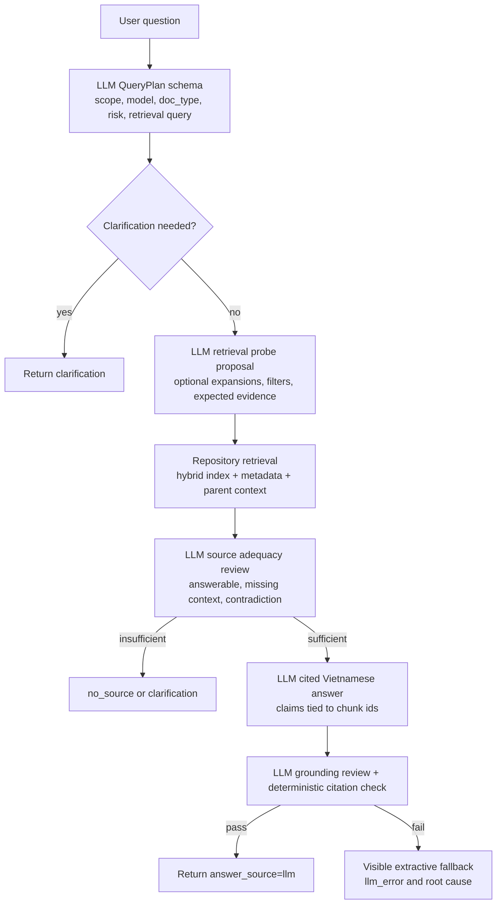

# LLM-Assisted Data And Audit Blueprint

Generated: 2026-06-21

This blueprint transfers the agreed architecture into the Baxter IC project without
turning an LLM, Pathway, RAGFlow, or any external framework into the project core.
It defines where large LLMs such as DeepSeek may help, what they are allowed to
decide, and what artifacts must exist before a result can be trusted.

## Purpose

Use strong local or API LLMs at hard reasoning points:

- detect noisy, incomplete, duplicated, or poorly structured document regions;
- propose RAG-friendly transformations for tables, warning blocks, service
  procedures, diagrams, Mermaid-style flows, and troubleshooting relationships;
- judge whether a data issue needs OCR, parser retry, local LLM, API LLM, a
  deterministic tool, or human review;
- validate answer grounding, citation support, and failure root cause during QA;
- create audit logs that help the project improve from real failures.

LLMs are reasoning workers. They are not source truth, not policy owners, and not
silent fallback paths.

## Authority Levels

| Level | Authority | Examples | Promotion Rule |
| --- | --- | --- | --- |
| Source | Canonical truth | Raw manuals under `documents/` | Never mutated. |
| Derived artifact | Repository-owned evidence | normalized Markdown, citation maps, chunks, metadata | Produced by pipeline from sources. |
| LLM proposal | Non-canonical suggestion | cleanup proposal, table interpretation, Mermaid flow draft | Must include evidence ids, confidence, risk, and action. |
| Validator judgment | Quality signal | citation support, answer drift, root-cause class | May block or route work; cannot invent facts. |
| Approved patch | Promoted change | safe cleanup or human-reviewed repair | Requires ledger entry and rollback path. |

## Core Principle

The system may be long-running when correctness requires it.

Sampling is allowed for triage, but any claim about corpus quality, answer
quality, or data readiness requires a full run, a resumable run, or an explicit
remaining-gap report.

## Blueprint Target

This is the target operating blueprint for the next implementation work. It is
not a license to let an LLM freely rewrite the corpus or answer from memory.

The intended design is a small auditable core with an explicit reasoning plane:

```text
observe artifact or user-answer failure
-> classify issue with source ids and risk
-> route to tool, local LLM, API LLM, or human
-> write schema-bound proposal or validator judgment
-> promote only through citation, risk, review, rebuild, and eval gates
-> log root cause so future runs fix the right layer
```

The LLM is strongest where the work is semantic: deciding whether a table is
broken, whether procedure steps were split badly, whether a Mermaid flow would
help retrieval, whether a retrieved context actually supports an answer, or
whether the root cause is data, retrieval, citation, or model drift. Tools remain
strongest where the work is reproducible: OCR, parsing, hashing, line mapping,
index building, citation map generation, and exact text checks.

## End-To-End Flow



## LLM Router

The router chooses the cheapest safe actor for each issue.

| Issue Type | Preferred Actor | Why |
| --- | --- | --- |
| Empty or missing page text | OCR/parser retry | LLM must not guess missing manual content. |
| Broken table layout | MinerU/layout tool, then LLM proposal | Table structure needs visual/layout evidence first. |
| Noisy header/footer/TOC repetition | Deterministic rule or local LLM proposal | Low-risk cleanup if evidence is exact. |
| Procedure step ordering | API LLM proposal + human review | Step order can affect service safety. |
| Alarm/action interpretation | API LLM validator + human review | High-risk technical guidance. |
| Mermaid/flow extraction | API LLM proposal | Useful for retrieval, but not source truth. |
| Answer drift or weak citation | LLM judge + deterministic citation check | Blocks answer quality regressions. |

## Data Loop-Check Blueprint

The data loop-check should be an explicit decision system, not a pile of
hardcoded cleanup rules. Each loop pass creates issues, routes them, and records
the decision trail.



### Data Issue Routing Matrix

| Signal | First Classifier | Preferred Route | Required Output | Promotion Rule |
| --- | --- | --- | --- | --- |
| Empty pages, image-only pages, weak embedded text | deterministic profiler | OCR or parser retry | `ocr_retry` queue with doc/page ids | Never let an LLM fill missing text. |
| Broken table rows, merged columns, lost units | layout/table profiler, then LLM router | MinerU/table tool, then API LLM proposal | `table_reconstruction_proposal` with exact spans and unit checks | Human review when table affects service, safety, alarm, or specs. |
| Header/footer/TOC repetition | deterministic profiler or local LLM | local LLM or safe cleanup proposal | `noise_removal_proposal` with exact before spans | Auto-promote only for exact low-risk duplicate removal. |
| Split warning/caution block | chunk/citation profiler, API LLM validator | API LLM proposal | `warning_block_repair_proposal` | Human review required. |
| Procedure steps split, merged, or out of order | chunk profiler, API LLM validator | API LLM plus human | `procedure_structure_proposal` | Human review required; preserve step order. |
| Troubleshooting relation unclear | retrieval/eval failure miner | API LLM relationship proposal | `relationship_graph_proposal` with citations | Metadata only until eval proves benefit. |
| Diagram or flow text present | section profiler, API LLM | Mermaid proposal | `mermaid_flow_proposal` plus source spans | Non-canonical retrieval aid unless reviewed. |
| Low-value boilerplate dominates chunks | deterministic profiler plus local LLM | low-risk proposal | `low_value_exclusion_proposal` | Must preserve source preview and rollback. |
| Retrieved answer fails citation support | answer QA | API/local LLM judge | `answer_grounding_review` with root cause | Blocks fluent answer or creates eval case. |

### RAG-Friendly Proposal Types

LLM proposals should produce derived, reviewable structures that improve RAG
without pretending to be the manual.

| Proposal Type | Purpose | Allowed Shape | Not Allowed |
| --- | --- | --- | --- |
| `table_markdown_proposal` | Convert noisy table text into readable Markdown table. | Headers, rows, units, citation ids, uncertainty notes. | Invent missing rows, units, limits, or part numbers. |
| `mermaid_flow_proposal` | Represent troubleshooting or service logic as a graph. | Mermaid text plus every edge backed by a quote. | Add causal edges not present in evidence. |
| `procedure_chunk_proposal` | Split or merge procedure blocks for retrieval. | Step ranges, step text, citation ids, order-preservation note. | Reorder service steps without explicit evidence and human review. |
| `warning_block_proposal` | Keep warning/caution text intact across chunks. | Warning text, surrounding context, risk label. | Summarize away caution language. |
| `metadata_enrichment_proposal` | Add candidate alarms, parts, software versions, tools, units. | Entity list with source spans and confidence. | Treat entity extraction as source truth before citation alignment. |
| `low_value_exclusion_proposal` | Mark repeated boilerplate as low-value. | Exact repeated spans and affected chunk ids. | Delete source text or hide source preview. |

## Actor Selection Policy

The router should choose an actor by privacy, evidence completeness, risk, and
semantic difficulty.

| Actor | Use For | Do Not Use For | Required Guard |
| --- | --- | --- | --- |
| Deterministic tool | OCR routing, parser retry, hashing, line maps, citation ids, duplicate exact-match checks. | Semantic judgment about service meaning. | Reproducible inputs and outputs. |
| Local LLM | Private low-risk cleanup proposals, keyword enrichment, short validator checks. | High-stakes service/safety decisions without human review. | Schema output and saved request/result. |
| API LLM such as DeepSeek | Hard reasoning: table intent, procedure structure, troubleshooting relations, answer grounding, root-cause classification. | Any case where external upload is not explicitly allowed. | Snippet minimization, schema output, audit log, risk labels. |
| AI Agent CLI such as Codex | Multi-artifact investigation, code/pipeline repair, eval creation, root-cause analysis, proposal integration, documentation updates. | Hot-path answering, hidden source mutation, or routine checks that a simple tool can do. | Explicit task scope, artifact inputs, patch/proposal outputs, verification command, reviewable transcript. |
| Human reviewer | Legal, regulatory, safety, service steps, alarm actions, policy, direction changes. | Bulk mechanical cleanup that can be exact and low risk. | Decision record or promotion note. |

Default routing order:

```text
deterministic evidence check
-> tool lane when source evidence is missing or layout-bound
-> local LLM when the task is private and low risk
-> API LLM when reasoning quality matters and upload is allowed
-> AI Agent CLI when the task needs tool use, code edits, cross-file reasoning, or long-run QA
-> human when risk, policy, or uncertainty is high
```

## AI Agent CLI Lane

An AI Agent CLI such as Codex is more than a plain LLM call. It can inspect
files, run commands, compare artifacts, patch code/docs, create eval cases, and
verify the result. That makes it valuable for audit and repair work, but too
heavy for every small runtime decision.

Use agent CLI for bounded, evidence-backed work:

- investigate a failed answer across chat logs, retrieval hits, citations,
  normalized Markdown, and source preview;
- inspect a quality-loop queue and propose a concrete repair plan;
- patch pipeline code, schemas, docs, or eval cases after a measured failure;
- compare before/after artifacts after OCR, normalization, chunking, or index
  changes;
- produce root-cause reports that connect failures to data, retrieval, citation,
  model, LLM, policy, or eval gaps;
- run verification commands and report exact pass/fail status.

Do not use agent CLI for:

- per-question hot-path chat answer composition;
- small deterministic checks such as hashing, JSON validation, line counting, or
  exact duplicate detection;
- direct manual/source mutation;
- high-risk service/safety patch promotion without human review;
- broad autonomous cleanup with no bounded issue list.

### Agent CLI Trigger Threshold

Prefer the smallest actor that can solve the problem:

| Situation | Actor |
| --- | --- |
| Exact, reproducible operation | deterministic tool |
| Single snippet semantic judgment | local/API LLM with schema |
| Many files, logs, evals, and code paths must be inspected together | AI Agent CLI |
| Pipeline behavior must be repaired or new tests/evals must be added | AI Agent CLI |
| Legal, safety, regulatory, or company policy decision | human reviewer |

This avoids the "using a buffalo knife to kill a chicken" problem: agent CLI is
reserved for tasks where its tool use and repair ability materially improve the
result.

### Agent Task Contract

Every agent-run task should have a compact contract:

```json
{
  "schema_version": "baxter_agent_task_v1",
  "task_id": "agent_...",
  "trigger": "failed_eval_case",
  "objective": "Find why this answer lacked the expected citation and propose a fix.",
  "input_refs": ["chat_log", "eval_case", "chunk_ids", "citation_ids"],
  "allowed_write_scope": ["docs/", "eval/", "baxter_rag/"],
  "forbidden_actions": ["mutate documents/", "hide fallback", "invent source facts"],
  "expected_outputs": ["root_cause_report", "patch_or_proposal", "verification_result"],
  "verification_commands": ["python -m baxter_rag.cli --root . eval-run --limit 5"],
  "requires_human_review": true
}
```

Agent outputs should land in normal project artifacts: review reports, ledgers,
patch proposals, eval cases, docs, or code changes. They should not be treated
as invisible memory.

## Structured LLM Contract

Every LLM call that influences data, routing, answer QA, or audit must use a
schema-bound output. Free-form text may be displayed to users, but system
decisions require structured fields.

Minimum fields:

- `task_name`
- `source_ids`
- `evidence_spans`
- `decision`
- `confidence`
- `risk_level`
- `reasoning_summary`
- `proposed_actions`
- `blocked_reason`
- `requires_human_review`

For data proposals, also include:

- `proposal_type`
- `before_reference`
- `after_preview`
- `citation_impact`
- `rollback_note`

For answer QA, also include:

- `grounded_claims`
- `unsupported_claims`
- `citation_errors`
- `missing_context`
- `safe_response_action`

### DeepSeek/OpenAI-Compatible Call Shape

DeepSeek should be called through the OpenAI-compatible chat completions shape,
with `response_format` when supported and a strict JSON-schema instruction when
the provider falls back to JSON object mode.

Required request envelope:

```json
{
  "model": "deepseek-v4-flash",
  "messages": [
    {"role": "system", "content": "You are a schema-bound Baxter technical reviewer..."},
    {"role": "user", "content": "{task payload with minimized source snippets}"}
  ],
  "temperature": 0,
  "response_format": {
    "type": "json_schema",
    "json_schema": {
      "name": "BaxterReviewSchema",
      "strict": true,
      "schema": {}
    }
  }
}
```

Required saved call record:

```json
{
  "schema_version": "baxter_llm_structured_call_v1",
  "call_id": "llm_...",
  "task_name": "semantic_markdown_review_propose_patch",
  "provider": "deepseek_openai_compatible",
  "model": "deepseek-v4-flash",
  "source_ids": ["doc_id", "chunk_id", "citation_id"],
  "external_upload_allowed": true,
  "request_path": "artifacts/reviews/.../request.json",
  "response_path": "artifacts/reviews/.../response.json",
  "validation": {"schema_valid": true, "guardrail_status": "needs_human_review"},
  "usage": {"prompt_tokens": 0, "completion_tokens": 0, "total_tokens": 0}
}
```

The saved record must never include API keys. If source snippets are sent to a
non-local endpoint, the log must show the explicit allow flag and the minimized
snippet scope.

## Data Stages For LLM Assistance

### 1. Conversion Review

- Compare page count, text density, embedded text ratio, empty pages, and table
  density.
- Route pages to MinerU/native retry/OCR before asking an LLM to reason about
  content.
- If evidence is absent, create an OCR queue item instead of a summary.

### 2. Normalization Review

- Detect broken headings, merged procedures, split warnings, duplicated headers,
  misplaced captions, and overlong chunks.
- Propose RAG-friendly Markdown, tables, or flow representations only from
  cited source spans.
- Never replace a canonical normalized file directly from an LLM response.

### 3. Technical Enrichment

- Extract candidate alarms, warnings, parts, software versions, service steps,
  maintenance steps, calibration steps, tools, units, and diagrams.
- Store enrichment as metadata/proposals until citation alignment passes.
- Use high-risk labels so service/safety changes go to human review.

### 4. Index And Retrieval QA

- Use eval failures to identify whether the problem is metadata, chunking,
  retrieval, reranking, model scope, or missing data.
- Prefer source-backed metadata and better chunks before adding a new framework.
- Benchmark Qdrant, rerankers, GraphRAG, Pathway, or RAGFlow only against
  measured failure groups.

### 5. Data Promotion QA

- Before a proposal becomes a promoted artifact, run deterministic checks for
  exact source spans, citation ids, changed chunk ids, and rollback notes.
- Run an LLM validator only to classify risk, missing evidence, and expected
  retrieval impact.
- Rebuild index and eval after promotion. If eval gets worse, record rollback
  guidance and classify the regression root cause.

## Answer Stages For LLM Assistance

LLMs may help with:

- query planning and scope inference;
- retrieval probe generation and source adequacy review;
- cited Vietnamese answer composition;
- citation support checking;
- contradiction/no-source detection;
- answer-quality judging during eval and audit.

LLMs must not:

- answer from model memory;
- hide provider failure;
- fabricate service guidance when retrieval is weak;
- turn extractive fallback into an unlabelled fluent answer;
- override no-source or clarification rules for demo convenience.

### Answer Reasoning Blueprint

The answer path should use LLMs as a staged reasoning workflow, while preserving
the public fallback contract.



Answer-stage schemas:

| Schema | Purpose | Key Fields |
| --- | --- | --- |
| `QueryPlan` | Infer scope and retrieval intent. | `model`, `doc_type`, `software_version`, `question_type`, `retrieval_query`, `needs_clarification`. |
| `RetrievalProbe` | Ask what evidence should exist before answering. | `query_variants`, `required_entities`, `preferred_doc_types`, `risk_level`, `stop_conditions`. |
| `SourceAdequacyReview` | Decide whether retrieved context is enough. | `answerable`, `missing_context`, `contradictions`, `safe_response_action`. |
| `CitedAnswer` | Compose answer only from context. | `answer`, `claims`, `citations`, `uncertainty_notes`. |
| `AnswerGroundingReview` | Validate citation support and drift. | `grounded_claims`, `unsupported_claims`, `citation_errors`, `root_cause`. |

The answer system may become more LLM-driven, but retrieval, citation mapping,
source preview, fallback labels, and eval ownership must stay repository-owned.

## Root-Cause Log Model

QA logs should classify failures so the next fix targets the right layer.

| Root Cause | Meaning | Typical Fix |
| --- | --- | --- |
| `source_missing` | Manual/source is absent from corpus. | Intake, manifest, policy review. |
| `conversion_loss` | Parser/OCR lost text, table, figure, or page. | MinerU/OCR/layout rerun. |
| `normalization_noise` | Markdown/chunks include noise or broken structure. | Cleanup proposal, chunk repair. |
| `metadata_gap` | Model/doc_type/version/alarm fields are weak. | Metadata enrichment. |
| `retrieval_miss` | Right source exists but not retrieved. | Query planning, filters, reranking, index tuning. |
| `context_insufficient` | Retrieval hit exists but answer lacks enough surrounding context. | Parent context or section expansion. |
| `llm_drift` | LLM added unsupported claims. | Citation validator, stricter prompt/schema, abstain. |
| `citation_error` | Claim and citation do not align. | Citation map repair or answer rejection. |
| `policy_block` | External upload/legal/safety boundary blocks action. | Human decision record. |
| `eval_gap` | Failure mode lacks a regression case. | Add eval case. |

## Modern Logs And Audit Spine

The logs should support system improvement, not just debugging. Every important
decision should be traceable from source artifact to answer or queued repair.

### Log Families

| Destination | Purpose | Example Events |
| --- | --- | --- |
| `logs/events/` | Append-only operational event stream. | stage started, stage completed, provider unavailable, fallback used. |
| `logs/llm_calls/` | Structured LLM request/result audit. | query plan, semantic review, answer grounding review. |
| `logs/chat/` | User-turn payloads and visible answer metadata. | answer_source, citations, llm_error, no_answer_reason. |
| `artifacts/pipeline/runs/` | End-to-end run state and stage reports. | preflight, conversion gate, LLM data review, eval. |
| `artifacts/quality_loop/runs/` | Long-running loop ledgers and queues. | OCR queue, human review patch queue, safe patch candidates. |
| `artifacts/reviews/` | LLM/tool proposals and review reports. | table proposal, Mermaid proposal, answer QA report. |
| `artifacts/root_cause/` | Aggregated failure analysis. | data vs retrieval vs model vs citation breakdown. |
| `eval/` | Regression cases and latest eval outputs. | failed question turned into test case. |

### Event Envelope

Every event that affects data, retrieval, answer, QA, or promotion should use a
shared envelope.

```json
{
  "schema_version": "baxter_audit_event_v1",
  "event_id": "evt_...",
  "trace_id": "trace_...",
  "run_id": "run_or_session_id",
  "timestamp": "2026-06-21T00:00:00Z",
  "stage": "answer_grounding_review",
  "actor_type": "api_llm",
  "actor_name": "deepseek-v4-flash",
  "input_refs": ["chunk_id", "citation_id"],
  "output_refs": ["proposal_id", "log_path"],
  "decision": "extractive_fallback",
  "confidence": 0.82,
  "risk_level": "high",
  "root_cause": "llm_drift",
  "fallback_visible": true,
  "external_upload_allowed": true,
  "requires_human_review": false,
  "error": null
}
```

### Trace Model

Use one `trace_id` across a whole data or answer journey.

For data:

```text
source_manifest record
-> conversion artifact
-> quality issue
-> LLM/tool/human proposal
-> promotion gate
-> rebuilt chunk/citation/index
-> eval result
-> root-cause summary
```

For chat:

```text
question
-> query plan
-> retrieval probe
-> search hits
-> source adequacy
-> answer composition
-> grounding review
-> final payload
-> feedback/eval case
```

### Root-Cause Rollup

Audit/QA should periodically aggregate events into a rollup such as:

```json
{
  "schema_version": "baxter_root_cause_rollup_v1",
  "period": "run_20260621",
  "counts": {
    "conversion_loss": 12,
    "normalization_noise": 31,
    "retrieval_miss": 7,
    "llm_drift": 2,
    "citation_error": 4
  },
  "top_failure_groups": [
    {
      "group_id": "empty_pages_prismax_aw8047",
      "root_cause": "conversion_loss",
      "recommended_next_action": "run OCR retry for listed pages",
      "evidence_refs": ["doc_id:page"]
    }
  ],
  "new_eval_cases": ["eval_case_id"]
}
```

This is how the project learns safely: not by memorizing facts, but by turning
observed failure patterns into queues, eval cases, and reviewed data repairs.

Minimum log destinations:

- `logs/chat/` for user turns and visible answer/fallback metadata;
- `artifacts/pipeline/` for pipeline reports and tool decisions;
- `artifacts/quality_loop/` for ledgers, queues, and proposal runs;
- `artifacts/reviews/` for LLM review requests, proposals, and reports;
- `eval/` for seed cases and latest evaluation output.

## Local/API LLM Policy

- Use local LLMs for private, low-risk proposal generation, short validation,
  and offline experimentation.
- Use API LLMs such as DeepSeek for difficult reasoning only when external
  upload is explicitly allowed and snippets are minimized.
- Use deterministic tools for parsing, OCR routing, hashing, citation mapping,
  and reproducible checks.
- Use humans for legal, regulatory, high-risk service/safety, company policy,
  and direction-changing decisions.

## Promotion Gate

A proposal can affect the core only when all are true:

1. Source spans and citation ids are present.
2. The change preserves raw-source immutability.
3. The risk level is compatible with auto-promotion, or a human approved it.
4. A rollback note exists.
5. The rebuild/eval path is known.
6. The result does not introduce hidden fallback or model-memory facts.

## Minimal Implementation Order

1. Keep current pipeline and quality loop as the core.
2. Standardize structured LLM schemas and save every influential request/result.
3. Expand data review queues by root-cause class.
4. Add answer QA logs that separate data, retrieval, citation, and model causes.
5. Add eval cases from every confirmed failure.
6. Benchmark optional tools only after the failure group is visible.
